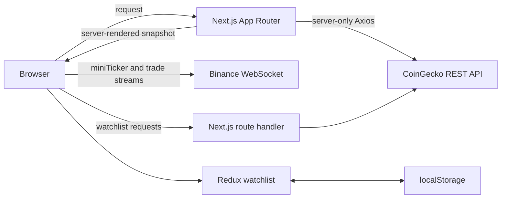

# Crypto Market Intelligence

A production-minded cryptocurrency dashboard built for the NMO Business Senior Frontend Developer challenge. It combines request-time market rankings, revalidated asset detail pages, a persistent Redux watchlist, and isolated Binance WebSocket streams in a responsive Next.js application.

- Live application: https://crypto-market-inelligence.vercel.app
- Source repository: https://github.com/yousefknifati/crypto-market-inelligence

## Product features

- Server-rendered top-100 market overview with asset search, gainers/losers filters, four sorting options, pagination, and incremental loading.
- Dynamic `/market/[id]` pages with market statistics, CoinGecko attribution, a keyboard-accessible seven-day price chart, CSV export, and proper 404s.
- Redux Toolkit watchlist with focused actions/selectors, localStorage persistence, hydration-safe restoration, watchlist search, and sorting.
- Binance `miniTicker` and trade streams with connected, reconnecting, and disconnected states, capped reconnect behavior, manual retry, and cleanup.
- Purposeful Motion route/card/list transitions that respect reduced motion.
- Explicit loading, empty, missing-data, error, and retry states.

## Tech stack

- Next.js 16 App Router, React 19, and TypeScript
- Tailwind CSS 4
- Redux Toolkit, React Redux, and TanStack React Query
- Axios for CoinGecko REST requests
- Motion for React
- Native browser WebSocket connections to Binance public market streams
- Vercel deployment

## Architecture and data flow



Server-fetched market responses remain outside Redux. Redux stores only the favorite asset IDs shared by the overview, detail, and watchlist interfaces. WebSocket state stays inside the small components that render it, preventing frequent ticks from rerendering the market table or page content.

## Rendering and caching decisions

### Request-time SSR: `/`

`MarketSnapshot` calls Next.js `connection()` before the uncached, server-only CoinGecko request. Market-cap rankings therefore reflect each incoming page request instead of a build-time snapshot. A local Suspense boundary streams the table skeleton while the surrounding dashboard renders. The freshness trade-off is one upstream market request and its latency per initial request.

The server passes the response to the interactive table. Search, filters, sorting, pagination, and watchlist controls run in the browser without duplicating the server response in Redux.

### ISR: `/market/[id]`

Asset detail and chart helpers use `use cache` with:

```ts
cacheLife({ stale: 60, revalidate: 60, expire: 300 });
```

Repeated detail visits can reuse data, requests after 60 seconds trigger background regeneration, and an entry unused for 300 seconds must refresh synchronously. This accepts modest staleness to reduce CoinGecko traffic while the separate Binance ticker supplies live prices.

### Client rendering

Client Components are limited to interaction or browser APIs: Redux persistence, React Query views, navigation drawer behavior, charts, Motion, toast rendering, and WebSocket subscriptions. The watchlist masks persisted values until Redux hydration finishes, avoiding server/client mismatches.

## Data sources

- CoinGecko REST API: rankings, global totals, asset details, and chart history.
- Binance public WebSocket: combined `miniTicker` and trade streams.

The interface labels unavailable fields instead of fabricating market values. Unsupported design concepts such as oracle verification, FIX connectivity, order-book depth, alerts, and long chart periods are disabled or omitted.

## Local setup

Requirements: Node.js 20 or newer and npm.

```bash
git clone https://github.com/yousefknifati/crypto-market-inelligence.git
cd crypto-market-inelligence
npm install
```

Create `.env.local`:

```dotenv
# Optional; defaults to https://api.coingecko.com/api/v3
COINGECKO_API_BASE_URL=https://api.coingecko.com/api/v3

# Recommended to improve CoinGecko demo-tier reliability. Never expose it with
# a NEXT_PUBLIC_ prefix.
COINGECKO_DEMO_API_KEY=your_demo_api_key

# Use the public production origin when deploying.
SITE_URL=http://localhost:3000

# Optional public override; this public endpoint is also the default.
NEXT_PUBLIC_BINANCE_WS_URL=wss://data-stream.binance.vision
```

Run and verify:

```bash
npm run dev
npm run lint
npm run build
npm run start
```

## Redux state design

The `watchlist` slice contains `favoriteIds` and a hydration flag. Its focused actions add, remove, toggle, and restore favorites; selectors expose the ID list, hydration state, and one asset's favorite state. The provider creates one store per application session, restores validated string IDs from localStorage after mount, and persists only after hydration.

## Performance decisions

- `MarketDataTable` memoizes the top-100 search/filter/sort pipeline.
- `WatchlistContent` memoizes its ID lookup and visible sorting pipeline.
- `MarketChartPanel` memoizes the 24-hour slice of the seven-day series.
- `MarketTableRow` uses `React.memo` because it is repeated and receives stable asset references; each row selects only its own favorite boolean.
- `HeaderToolbar` and `LiveTicker` are memoized around frequent header ticks.
- Drawer and search callbacks use `useCallback` so memoized descendants receive stable function identities.
- Small fixed-size calculations remain unmemoized to avoid needless complexity.
- Coin logos use `next/image`; the noncritical trade widget and toaster are loaded with `next/dynamic`.
- WebSocket updates stay in the header, connection badge, or live panel and are never copied into Redux or a page-level context.

## Motion and interaction

Route content uses a short fade/vertical reveal. Summary and fundamental cards use one reusable stagger component with a small hover lift. Market rows receive pointer and keyboard-focus emphasis, and the favorite star uses a restrained scale/rotation interaction. `useReducedMotion` and global reduced-motion CSS remove movement while retaining focus, status, and color feedback.

## SEO

- Unique home and dynamically generated asset titles/descriptions.
- Canonical URLs, Open Graph metadata, and Twitter card metadata.
- `app/robots.ts` and `app/sitemap.ts` using Next.js metadata conventions.
- `WebSite`, `Dataset`, and breadcrumb JSON-LD with escaped serialization.
- Server-rendered primary market/detail content and ordered heading levels.
- Localhost output is `noindex`; Vercel's production origin is a safe fallback when `SITE_URL` is omitted.

## Accessibility and resilience

- Skip link, visible focus states, semantic navigation, labeled fields, and names for icon-only controls.
- Focus-trapped mobile drawer with Escape close and trigger-focus restoration.
- Keyboard chart inspection with Arrow keys, Home, and End.
- Status text/icons supplement color for trends and connection state.
- Responsive overflow handling for dense market tables.
- Retryable REST failures and distinct loading, empty, and missing-data states.
- Defensive external-response checks and nullable field fallbacks.
- WebSocket validation, capped reconnects, manual retry, and socket/timer cleanup.
- Secrets remain server-side in ignored environment files or deployment settings.

## Deployment

1. Import the repository into Vercel.
2. Add `COINGECKO_DEMO_API_KEY` to Production and Preview environments.
3. Set `SITE_URL` to the stable public production origin.
4. Deploy from the final commit.
5. Verify `/`, `/watchlist`, `/market/bitcoin`, an invalid asset URL, `/robots.txt`, `/sitemap.xml`, and live WebSocket status.

The deployment must remain publicly reachable without Vercel authentication.

## AI Usage

Codex was used to accelerate Figma inspection, component scaffolding, API and type tracing, accessibility review, SEO setup, Motion integration, and final verification. Every change was reviewed against the installed Next.js 16 documentation and the challenge requirements.

One generated approach dynamically imported the live Client Component directly from a Server Component. The installed Next.js documentation states that this does not provide automatic code splitting, so it was corrected to use a small client wrapper with `ssr: false`. Static design claims for FIX connectivity and oracle verification were also rejected because the implemented sources could not substantiate them.

## Known limitations and next-day improvements

- CoinGecko demo-tier rate limits can temporarily reduce REST availability.
- Favorites are browser-local and do not sync between devices.
- The overview loads the top 100 assets and filters them client-side; a larger catalog would need server pagination or virtualization.
- Historical data is limited to a seven-day area chart. Candles, depth, alerts, and longer periods require additional data sources and backend services.
- Header/sidebar/detail price badges currently use isolated sockets. At larger scale, a shared external store should multiplex one connection and selectors.
- Non-core sidebar destinations and account controls remain disabled.
- Automated selector/component tests and CI are optional challenge bonuses and have not been added; they are the first delivery-discipline improvement.
